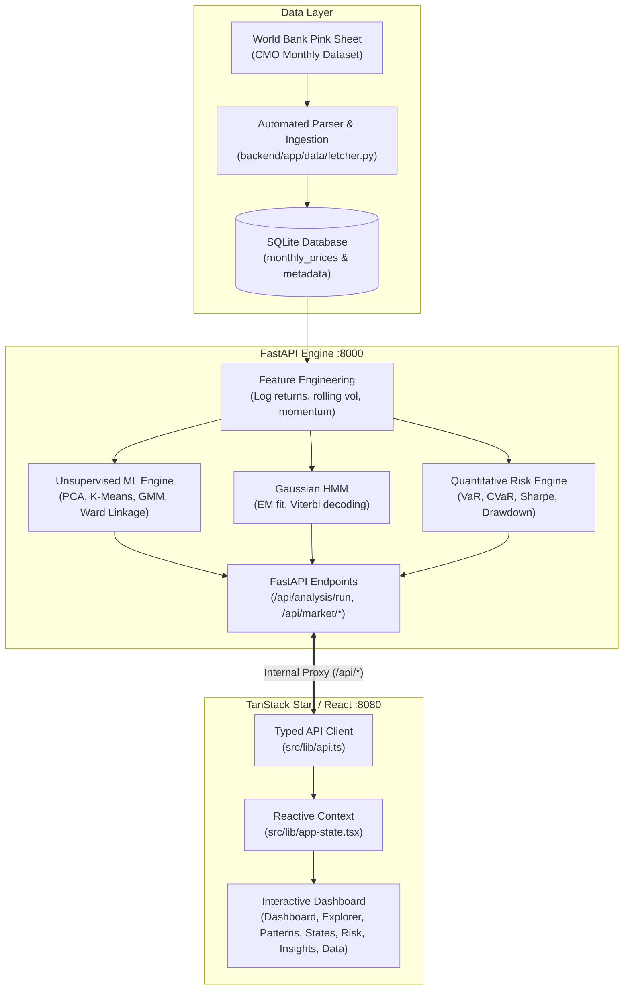

# CommodiSense

**Commodity Market Regime Discovery, Machine Learning & Quantitative Risk Intelligence Platform**

CommodiSense is a full-stack financial analytics application designed to uncover hidden market regimes, structural clustering patterns, and quantitative risk metrics across macro commodities—specifically **Gold (USD/troy oz)** and **Brent Crude Oil (USD/bbl)**.

Powered by verified monthly historical data from the **World Bank Pink Sheet** (1960–present), CommodiSense pairs a high-performance **FastAPI** analytical engine with a modern **TanStack Start & React** user interface.

---

## Key Highlights

- **Authentic Historical Ingestion**: Automated ingestion and local SQLite persistence of official World Bank *Commodity Markets Outlook* (Pink Sheet) monthly data spanning over 800 observations (1960–present).
- **Unsupervised Pattern Discovery**:
  - **K-Means Clustering** with $k$-means++ initialization.
  - **Gaussian Mixture Models (GMM)** with Expectation-Maximization and full covariance modeling.
  - **Agglomerative Hierarchical Clustering** using Ward’s minimum-variance linkage, featuring an interactive SVG **Dendrogram** with mathematical cluster-cut thresholding ($d_{\text{cut}}$).
- **Hidden Market Regimes (HMM)**: Discrete-state Gaussian Hidden Markov Models with Expectation-Maximization fitting, Viterbi path decoding, and transition probability matrices.
- **Dimensionality Reduction**: Principal Component Analysis (PCA) projection ($PC1 \times PC2 \times PC3$) with explained variance ratios and feature loadings.
- **Rigorous Risk Analytics**:
  - Non-parametric Historical Value at Risk (**VaR** at 95% and 99% confidence).
  - Conditional Value at Risk (**CVaR** / Expected Shortfall).
  - Maximum Peak-to-Trough Drawdown.
  - Frequency-correct annualized volatility ($\sqrt{12}$ annualization factor for monthly series).
  - Annualized **Sharpe Ratio** benchmarked against a documented 2.5% risk-free rate assumption.
- **Enterprise-Grade Architecture**: Zero synthetic fabrication presented as genuine historical data; transparent labeling between real verified historical data and offline simulation fallbacks.

---

## System Architecture



---

## Analytical Methodology & Formulas

### 1. Log Returns
Monthly compounded returns are calculated via natural logarithmic differentials:
$$r_t = \ln\left(\frac{P_t}{P_{t-1}}\right) \times 100$$

### 2. Frequency-Correct Volatility Annualization
Because commodity observations occur on a monthly cadence, annualization uses the square-root-of-time rule with 12 periods per year (avoiding daily $\sqrt{252}$ distortions):
$$\sigma_{\text{ann}} = \sigma_{\text{monthly}} \times \sqrt{12}$$

### 3. Non-Parametric Value at Risk (VaR)
For a chosen confidence level $\alpha \in \{0.95, 0.99\}$ over returns distribution $R$:
$$\text{VaR}_\alpha = -\text{Percentile}(R, 1 - \alpha)$$

### 4. Conditional Value at Risk (CVaR / Expected Shortfall)
The expected loss conditioned on breaching the VaR threshold:
$$\text{CVaR}_\alpha = -\mathbb{E}[R \mid R \le -\text{VaR}_\alpha]$$

### 5. Sharpe Ratio
$$\text{Sharpe} = \frac{\bar{r}_{\text{ann}} - R_f}{\sigma_{\text{ann}}}$$
*Where $R_f$ is explicitly fixed at 2.50% annualized.*

### 6. Hierarchical Ward Dendrogram Linkage
Distance between clusters $u$ and $v$ merged from clusters $s$ and $t$:
$$d(u, v) = \sqrt{\frac{|s| + |v|}{|s| + |t| + |v|} d(s,v)^2 + \frac{|t| + |v|}{|s| + |t| + |v|} d(t,v)^2 - \frac{|v|}{|s| + |t| + |v|} d(s,t)^2}$$
The cluster-cut height $d_{\text{cut}}$ is calculated as:
$$d_{\text{cut}} = \frac{Z_{-(k-1), 2} + Z_{-k, 2}}{2}$$

---

## Application Structure

```text
commodisense/
├── backend/                        # Python FastAPI Backend
│   ├── app/
│   │   ├── data/                   # Data fetching, SQLite storage, feature computation
│   │   │   ├── fetcher.py          # World Bank XLSX download & parsing
│   │   │   ├── features.py         # Financial returns, rolling metrics, scaling
│   │   │   ├── manager.py          # MarketDataManager singleton
│   │   │   └── synthetic.py        # Seeded deterministic demo fallback
│   │   ├── ml/                     # Machine learning algorithms
│   │   │   ├── clustering.py       # PCA, K-Means, GMM, Ward Linkage, Dendrogram
│   │   │   ├── hmm.py              # Gaussian Hidden Markov Model
│   │   │   └── risk.py             # VaR, CVaR, Sharpe, Max Drawdown
│   │   ├── persistence/            # SQLite tables & query models
│   │   ├── routers/                # REST API routers (analysis, market, health)
│   │   ├── schemas/                # Pydantic request & response models
│   │   ├── config.py               # Application settings
│   │   └── main.py                 # FastAPI application factory & CORS configuration
│   ├── data/
│   │   ├── raw/                    # Cached World Bank Pink Sheet workbooks
│   │   └── commodisense.db         # Persistent SQLite database
│   ├── tests/                      # Pytest automated test suite (21 tests)
│   └── server.py                   # Backend entrypoint (uvicorn on port 8000)
├── src/                            # Frontend Application (TanStack Start / React)
│   ├── components/
│   │   ├── analysis.tsx            # ConfigurePanel, AnalysisResults, DataSourcesPage
│   │   ├── app-shell.tsx           # Layout, navigation, top bar, connection pill
│   │   ├── pages.tsx               # ExplorerPage, PatternsPage, StatesPage, RiskPage
│   │   └── widgets.tsx             # PriceChart, DendrogramChart, KpiCard, Badges
│   ├── lib/
│   │   ├── analysis-config.ts      # Analysis parameters, validation, presets
│   │   ├── api.ts                  # Typed client for backend REST contract
│   │   ├── app-state.tsx           # React Context for cross-application state
│   │   ├── market-data.ts          # Formatting, utilities, fallback series
│   │   └── utils.ts                # Styling utilities
│   ├── routes/                     # TanStack Start file-based routing
│   │   ├── api/$.ts                # SSR reverse proxy relaying /api to port 8000
│   │   ├── dashboard.tsx           # Main overview dashboard
│   │   ├── patterns.tsx            # Pattern discovery route
│   │   ├── risk.tsx                # Quantitative risk route
│   │   └── ...
│   └── test/                       # Vitest frontend routing & validation tests
├── package.json                    # Node dependencies and build scripts
└── vite.config.ts                  # Vite & TanStack Start build configuration
```

---

## Getting Started

### Prerequisites

- **Node.js**: `v18.0.0` or higher (Node 20+ recommended)
- **Python**: `v3.10` or higher
- **Package Managers**: `npm` and `pip`

---

### Step 1: Install Dependencies

#### 1. Backend Python Dependencies
From the repository root, install the required packages:

```bash
pip install fastapi uvicorn numpy scipy scikit-learn openpyxl pytest httpx
```

#### 2. Frontend Node Dependencies
From the repository root:

```bash
npm install
```

---

### Step 2: Start the Application

CommodiSense runs as two integrated processes: the Python analytical backend and the Vite development server.

#### Terminal 1 — Start the Backend Server
```bash
python backend/server.py
```
- **Service**: FastAPI + Uvicorn
- **URL**: `http://127.0.0.1:8000`
- **Swagger Documentation**: `http://127.0.0.1:8000/docs`
- **Health Check**: `http://127.0.0.1:8000/api/health`

#### Terminal 2 — Start the Frontend Dev Server
```bash
npm run dev
```
- **Service**: TanStack Start / Vite
- **URL**: `http://localhost:8080`

Open your browser to **[http://localhost:8080](http://localhost:8080)** to access the platform.

---

## API Reference

The backend exposes a standardized REST contract:

| Endpoint | Method | Description |
| :--- | :---: | :--- |
| `/api/health` | `GET` | Service status, software version, and provider health. |
| `/api/market/summary` | `GET` | Observation count, date ranges, quality indicators, and outlier audits. |
| `/api/market/prices` | `GET` | Historical price series filtered by commodity, period, and interval. |
| `/api/market/refresh` | `POST` | Fetches/verifies latest World Bank Pink Sheet workbook and updates SQLite. |
| `/api/analysis/run` | `POST` | Executes complete quantitative pipeline (clustering, PCA, HMM, risk). |
| `/api/models/kmeans/run` | `POST` | Runs standalone K-Means clustering. |
| `/api/models/gmm/run` | `POST` | Runs standalone Gaussian Mixture Model. |
| `/api/models/hierarchical/run`| `POST` | Runs Agglomerative clustering and returns complete dendrogram tree. |
| `/api/models/pca/run` | `POST` | Performs Principal Component Analysis. |
| `/api/models/hmm/fit` | `POST` | Fits Gaussian HMM parameters. |

---

## Automated Test Suites

Both backend and frontend layers include comprehensive test suites to guarantee numerical precision and API compatibility.

### Run Backend Tests (Pytest)
```bash
python -m pytest -o "pythonpath=backend" backend/tests
```
*Validates 21 tests covering contracts, SQLite integrity, log returns, rolling volatility, K-Means, GMM, Ward linkage dendrogram generation, PCA variance bounds, HMM probabilities, and VaR/CVaR calculations.*

### Run Frontend Tests (Vitest)
```bash
npm test
```
*Validates parameter validation rules, boundary conditions, and file routing.*

### Run Production Build
```bash
npm run build
```
*Compiles optimized client and SSR server bundles via Nitro.*

---

## Data Provenance & Outlier Transparency

CommodiSense relies on the **World Bank Development Prospects Group Commodity Price Data** (*The Pink Sheet*):
- **Gold**: 99.5% fine, London afternoon fixing, average of daily rates, USD/troy ounce.
- **Crude Oil (Brent)**: Light crude 38° API, F.O.B. U.K. ports, USD/barrel.

> **Data Integrity Notice**: Extreme price fluctuations (such as the 1973/1979 oil crises, the 1980 gold peak, and the 2008/2020 market shocks) are verified historical events. They are preserved intact in the database to reflect authentic tail-risk and heavy-tailed distribution dynamics.

---

## License

This project is licensed under the [MIT License](LICENSE).
